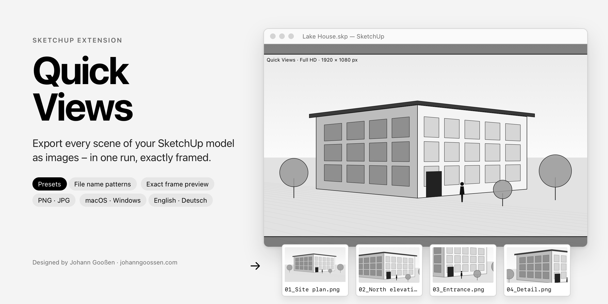
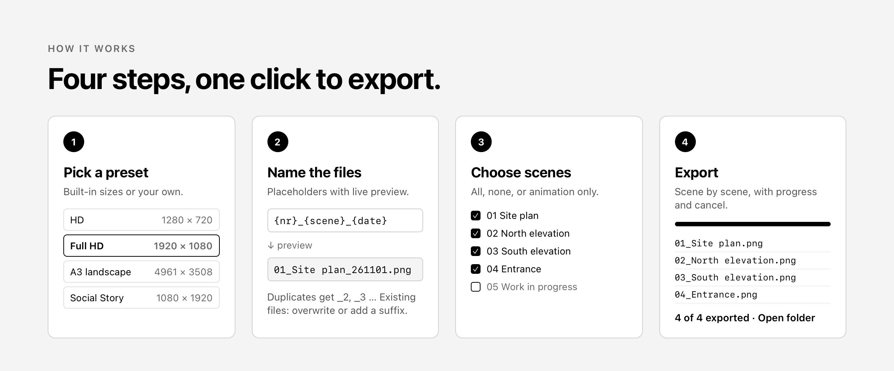
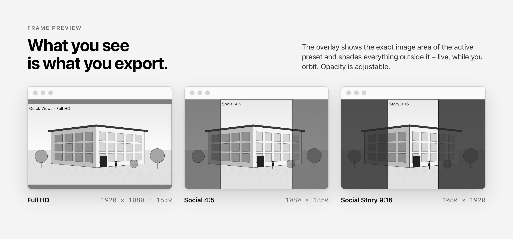
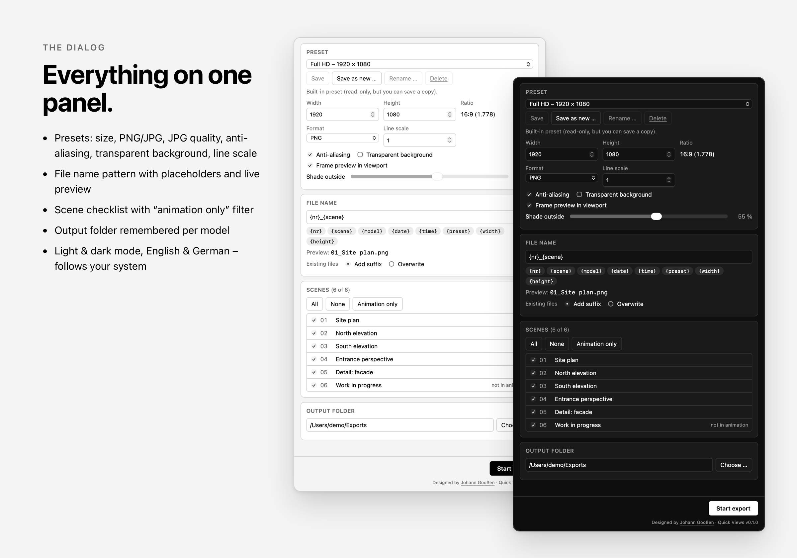

# Quick Views for SketchUp



**Quick Views** is a free SketchUp extension that exports all or selected scenes of a model as images in one run. You set the size, format and file names once, press *Start export*, and Quick Views goes through the scenes one by one. A frame preview in the viewport shows exactly which part of the view ends up in the image.

It is made for architects, designers and everyone who regularly needs a set of views – for a presentation, a competition, a client update or social media – and doesn't want to export them one at a time.

**[⬇ Download the latest release](https://github.com/johanngoossen/sketchup-quickviews/releases/latest)** · macOS & Windows · English & German

---

## Features

- **Batch export** of all or selected scenes as PNG or JPG, scene by scene, with progress bar and cancel. An error in one scene doesn't stop the run; the summary lists it.
- **Presets** for common sizes – HD, Full HD, 4K, A4/A3 at 300 dpi, square, Social 4:5, Social Story 9:16, or the current window size. Create, copy, rename and delete your own presets; they are available in every model.
- **Image options:** JPG quality, anti-aliasing, transparent background (PNG) and line scale (line widths and text).
- **File name patterns** with placeholders and a live preview, e.g. `{nr}_{scene}` → `01_Site plan.png`. Invalid characters are replaced, duplicates get `_2`, `_3`, and you decide whether existing files are overwritten or kept.
- **Exact frame preview:** an overlay shows the image area of the active preset and shades everything outside it, live while you orbit. The shade opacity is adjustable.
- **Clean model:** scene transitions are switched off during the export and everything – active scene, camera, style, tags – is restored afterwards. Nothing is added to the undo history.
- **Output folder** is remembered per model.
- **Light & dark mode** and **English & German**, following your system.







---

## Requirements

- **SketchUp 2023 or newer** on macOS or Windows (tested with SketchUp 2026 and 2027 on macOS).
- Older versions (2017+) can export, but the frame preview needs SketchUp 2023 and is greyed out there.

## Installation

Download the file for your system from the **[latest release](https://github.com/johanngoossen/sketchup-quickviews/releases/latest)**. All three options install the same extension.

### macOS – installer package

1. Quit SketchUp.
2. Download `QuickViews-<version>-macOS.pkg` and double-click it.
3. Follow the installer (it asks for your Mac password). It installs Quick Views for every SketchUp version found in your user account.
4. Start SketchUp → **Extensions › Quick Views**.

> **“Apple could not verify …” / “unidentified developer”:** the package is not signed with an Apple Developer ID. Open **System Settings › Privacy & Security**, scroll down and click **Open Anyway** next to the Quick Views message, then confirm. (On older macOS versions: right-click the file → **Open**.)

### Windows – installer

1. Quit SketchUp.
2. Download `QuickViews-<version>-Windows-Installer.cmd` and double-click it.
3. If Windows SmartScreen shows “Windows protected your PC”, click **More info › Run anyway**.
4. A console window shows where Quick Views was installed (every SketchUp version of your user, no admin rights needed). Press any key to close it.
5. Start SketchUp → **Extensions › Quick Views**.

### Any system – Extension Manager (.rbz)

1. Download `jg_quickviews-<version>.rbz`.
2. In SketchUp open **Extensions › Extension Manager › Install Extension** and choose the file.

### Uninstall / update

- **Uninstall:** *Extensions › Extension Manager*, find **Quick Views**, click **Uninstall**. Or delete `jg_quickviews.rb` and the folder `jg_quickviews` from the SketchUp `Plugins` folder.
- **Update:** run the new installer (or install the new `.rbz`); it replaces the old version. Your presets and settings are kept.

---

## Using Quick Views

Open the dialog via **Extensions › Quick Views › Export Scenes …** or the **Quick Views** toolbar. The second toolbar button switches the frame preview on and off.

1. **Preset** – choose a size. Built-in presets can't be changed, but edited values still apply to the next export; *Save as new …* keeps them as your own preset.
2. **File name** – type a pattern or click the placeholder chips. The preview shows the name of the first selected scene.
3. **Scenes** – tick the scenes to export. *Animation only* selects the scenes that are marked “Include in animation”.
4. **Output folder** – choose where the images go.
5. **Start export** – when it's done, *Open folder* shows the results.

### Placeholders

| English | German | Result |
|---|---|---|
| `{nr}` | `{nr}` | Position of the scene in the model, two digits (`01`, `02`, …) |
| `{scene}` | `{szene}` | Scene name |
| `{model}` | `{modell}` | Model file name |
| `{date}` | `{datum}` | Export date as YYMMDD, e.g. `261101` |
| `{time}` | `{zeit}` | Export start time as HHMM |
| `{preset}` | `{preset}` | Preset name |
| `{width}` / `{height}` | `{breite}` / `{hoehe}` | Image size in pixels |

Both spellings work in either language. Date and time are taken once when the export starts, so all images of one run share them.

### Language

Quick Views uses German when SketchUp runs in German and English otherwise. SketchUp follows the language of your operating system.

---

## How the frame works

`View#write_image` keeps the camera's locked extent (height, or width if `fov_is_height?` is false; `camera.height` for parallel projection) when the image has a different aspect ratio than the window. For an image wider than the window it would therefore show **more** than you see.

Quick Views always exports exactly the **largest centred rectangle with the preset's aspect ratio that fits into the visible viewport** – the rectangle the overlay draws. Where `write_image` would show more, Quick Views narrows the field of view of the live camera for the duration of the export and restores it afterwards. Scene cameras are never modified. Scenes with a fixed `camera.aspect_ratio` are handled by treating the area between the bars as the visible viewport. The geometry lives in `src/jg_quickviews/frame_math.rb` and was verified with the spike in `spike/`.

## Known limitations

- **Maximum resolution** depends on the graphics card and driver. Very large images (e.g. A3 at 300 dpi with anti-aliasing) may fail; the scene is then reported as an error.
- **JPG quality** assumes that `:compression` 1.0 means best quality (like the slider in SketchUp's export dialog).
- **Viewport preset** uses the window size in logical points; on Retina displays that is not the physical pixel count.
- **Two-point perspective with 2D pan/zoom:** restoring the original camera loses the 2D pan/zoom (the API has no setter for it). The export itself is not affected.
- **Unsaved view changes:** if style or tags were changed after selecting the current scene without updating it, they are restored to the state before the export; other scene properties (hidden objects, section planes) to the state of the scene.

---

## Development

```
src/jg_quickviews.rb                 Loader, registers the SketchupExtension
src/jg_quickviews/main.rb            Menu, toolbar, reload, settings migration
src/jg_quickviews/l10n.rb            English/German texts (Ruby side)
src/jg_quickviews/presets.rb         Presets, stored as JSON via Sketchup.write_default
src/jg_quickviews/filename_pattern.rb
src/jg_quickviews/frame_math.rb      Frame and camera geometry (overlay + export)
src/jg_quickviews/frame_overlay.rb   Sketchup::Overlay
src/jg_quickviews/exporter.rb        Timer-driven export, save/restore state
src/jg_quickviews/dialog.rb          UI::HtmlDialog and callbacks
src/jg_quickviews/ui/                HTML, CSS, JS (i18n.js = dialog texts)
installer/                           macOS package scripts, Windows installer template
docs/                                README images and their HTML sources
```

| Command | Purpose |
|---|---|
| `ruby test/test_core.rb` | Tests for file names, collisions, frame geometry, presets, translations (no SketchUp needed) |
| `tools/install_dev_loader.sh 2027` | Loads Quick Views directly from `src/` (macOS); adds *Extensions › Quick Views › Reload*. Remove with `--remove`. |
| `tools/build_rbz.sh` | Builds `dist/jg_quickviews-<version>.rbz` |
| `tools/build_installers.sh` | Builds the `.rbz`, the macOS `.pkg` and the Windows `.cmd` installer into `dist/` |
| `tools/render_images.sh` | Renders the README images from `docs/src/` with WebKit (macOS) |
| `python3 tools/make_icons.py` | Toolbar icons as SVG (Windows) and PDF (macOS) |
| `src/jg_quickviews/ui/dialog.html?mock&lang=en` | Dialog in a browser with `dev_mock.js` (via a local HTTP server; not packaged) |

### Spike: checking the frame model

1. Open a **new, empty model** in SketchUp (the spike changes camera and style).
2. Ruby console: `load "<repo>/spike/frame_spike.rb"`
3. Terminal: `python3 spike/analyze.py` – prints found vs. predicted marker positions and exits with 0 when they match within 3 px.

---

## License

MIT – see [LICENSE](LICENSE).

Designed by **[Johann Gooßen](https://johanngoossen.com)**.
